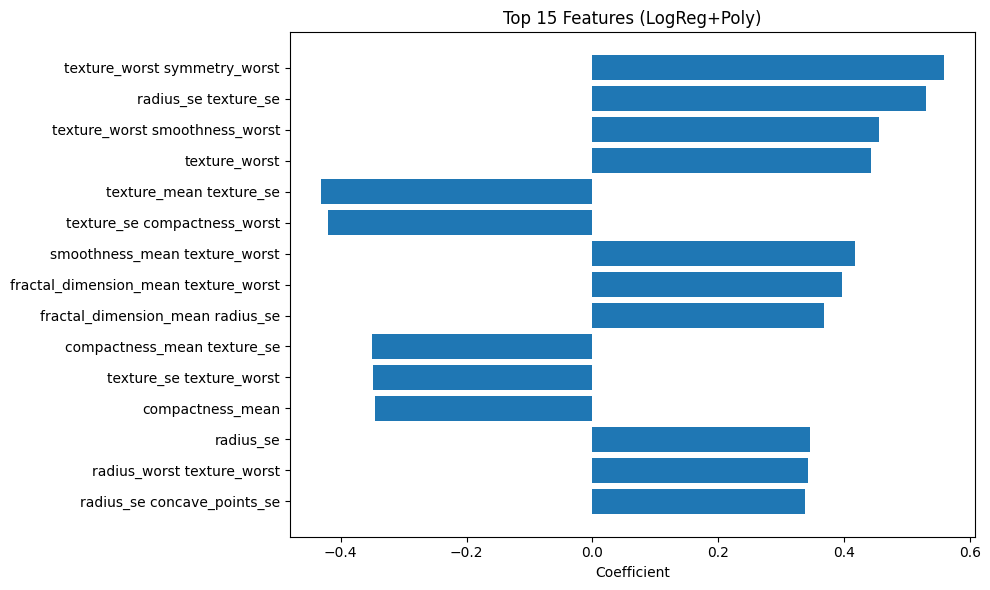
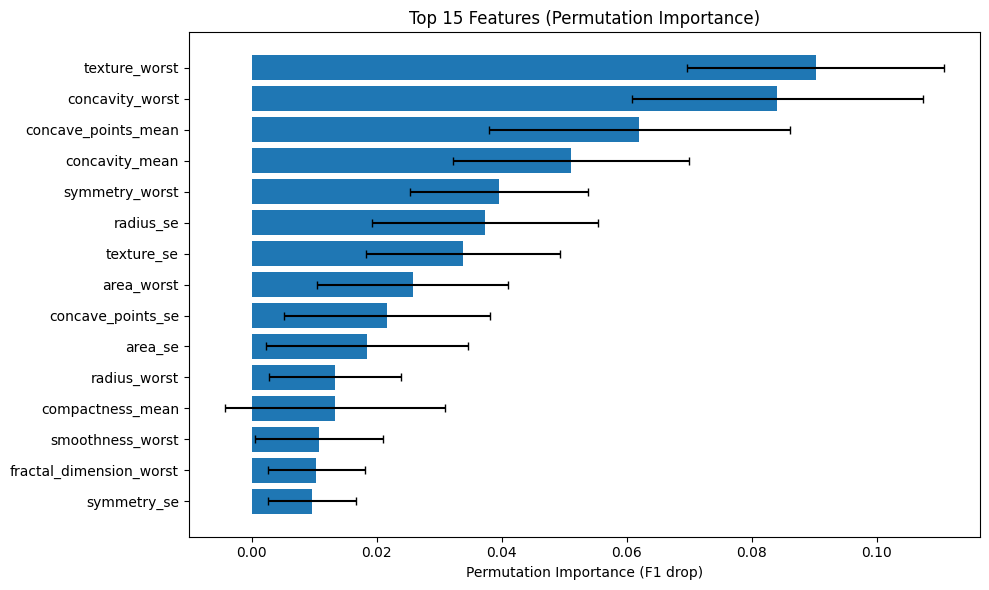

# Breast Cancer Classification

Binary classification of benign and malignant breast tumor samples using the **Wisconsin Diagnostic Breast Cancer (WDBC)** dataset. This project compares Polynomial Logistic Regression with Random Forest and selects probability thresholds using cross-validation on the training set.

## Results at a Glance

| Model | Threshold | Accuracy | Precision (Malignant) | Recall (Malignant) | F1 (Malignant) |
|:---|---:|---:|---:|---:|---:|
| **Polynomial Logistic Regression** | **0.40** | **0.9737** | **0.9756** | **0.9524** | **0.9639** |
| Random Forest | 0.36 | 0.9649 | 0.9750 | 0.9286 | 0.9512 |

**Key findings:**
- Polynomial Logistic Regression achieved the strongest result on the held-out test split.
- The selected thresholds were determined from five-fold out-of-fold predictions on the training data, not from the test set.
- At the selected thresholds, Logistic Regression missed 2 malignant samples; Random Forest missed 3.
- These results describe one stratified hold-out split and should not be interpreted as clinical performance.

## Project Overview

The goal is to build and compare machine-learning classifiers that distinguish benign from malignant samples using 30 numeric measurements. The positive class is **Malignant (1)**, so precision, recall, and F1-score are reported for that class.

## Dataset

**Wisconsin Diagnostic Breast Cancer (WDBC)**

- 569 samples
- 30 numeric features
- 357 benign samples and 212 malignant samples
- Diagnosis encoding: `B = 0` (Benign), `M = 1` (Malignant)

The raw file `wdbc.data` is not included in this repository. Download it from the [UCI Machine Learning Repository](https://archive.ics.uci.edu/dataset/17/breast+cancer+wisconsin+diagnostic) and place it in the `data/` directory. See [data/README.md](data/README.md).

## Methodology

1. Load the WDBC data, remove the identifier column, and encode the diagnosis.
2. Create an 80/20 train-test split using stratified sampling (`random_state=42`).
3. Train Polynomial Logistic Regression using degree-2 polynomial features and standardization.
4. Train a 300-tree Random Forest with balanced class weights.
5. Generate five-fold out-of-fold probabilities on the training set.
6. Select the threshold that maximizes pooled malignant-class F1-score for each model.
7. Evaluate each selected model once on the held-out test set.
8. Inspect polynomial coefficients and permutation importance.

## Model Interpretation

- Polynomial coefficients are measured in the transformed and standardized feature space; they are not direct effects in the original measurement units.
- Permutation importance is an exploratory analysis on the held-out test set. It is not used for model selection or threshold tuning.

## Visualizations

The notebook includes two model-interpretation plots:

- Polynomial Logistic Regression coefficients in the transformed feature space.
- Permutation importance measured by the decrease in malignant-class F1-score.





## Repository Structure

```text
-Breast-Cancer-Classification/
├── data/
│   └── README.md
├── notebooks/
│   └── Breast_Cancer_Classification.ipynb
├── reports/
│   └── Breast_Cancer_Classification_Report.pdf
├── .gitignore
├── README.md
└── requirements.txt
```

## How to Run

```bash
git clone https://github.com/farhan0060/-Breast-Cancer-Classification.git
cd -Breast-Cancer-Classification

python -m venv .venv
# Windows: .venv\\Scripts\\activate
source .venv/bin/activate

pip install -r requirements.txt
```

Place `wdbc.data` in `data/`, then launch Jupyter from the repository root:

```bash
jupyter notebook notebooks/Breast_Cancer_Classification.ipynb
```

## Technologies

- Python
- NumPy
- Pandas
- Matplotlib
- Scikit-learn
- Jupyter Notebook

## Limitations

- The reported metrics come from one stratified hold-out split.
- The dataset is a small benchmark and may not represent other populations or clinical settings.
- The threshold objective is F1-score; real screening decisions require explicit consideration of the costs of false negatives and false positives.
- Independent external validation would be required before any practical application.

## Disclaimer

This is an educational machine-learning project, not a medical diagnostic system. It must not be used to make medical decisions.
